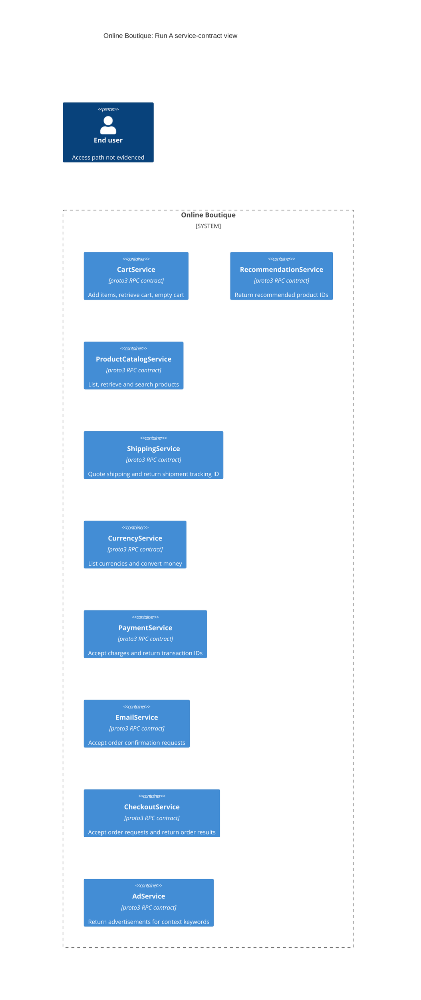

# Run A: Recovered architecture

## Agent

Codex (GPT-6).

## Files read

- `prompts/1-recover-architecture.md` — task instructions.
- `system/online-boutique/protos/demo.proto` — sole architectural evidence.

## Containers table

Scope: the file declares nine service interfaces, represented below as services. Their deployment as separate runtime containers is **Not evidenced in the provided files**.

The technology column describes the contract: Protocol Buffers `proto3` is declared at `system/online-boutique/protos/demo.proto:15`. Implementation languages are **Not evidenced in the provided files**; `option go_package` at line 19 specifies a Go package option, not each service's implementation language.

| Name | Technology/language | Responsibility exposed by the contract | Evidence (file path and symbol) |
| --- | --- | --- | --- |
| CartService | Protocol Buffers (proto3); implementation language unknown | Add cart items, retrieve a user's cart, and empty it. | `system/online-boutique/protos/demo.proto:23-27` — `CartService.AddItem/GetCart/EmptyCart`; requests at lines 34-45. |
| RecommendationService | Protocol Buffers (proto3); implementation language unknown | Return recommended product IDs for a user and supplied product IDs. | `system/online-boutique/protos/demo.proto:56-67` — `RecommendationService.ListRecommendations`, request/response fields. |
| ProductCatalogService | Protocol Buffers (proto3); implementation language unknown | List products, retrieve a product by ID, and search products by query. | `system/online-boutique/protos/demo.proto:71-103` — `ProductCatalogService.ListProducts/GetProduct/SearchProducts`, request/response fields. |
| ShippingService | Protocol Buffers (proto3); implementation language unknown | Quote shipping cost and accept a shipment request returning a tracking ID. | `system/online-boutique/protos/demo.proto:107-128` — `ShippingService.GetQuote/ShipOrder`, request/response fields. |
| CurrencyService | Protocol Buffers (proto3); implementation language unknown | List supported currencies and convert a money amount to a requested currency. | `system/online-boutique/protos/demo.proto:140-143,163-173` — `CurrencyService.GetSupportedCurrencies/Convert`, request/response fields. |
| PaymentService | Protocol Buffers (proto3); implementation language unknown | Accept an amount and card details for a charge; return a transaction ID. | `system/online-boutique/protos/demo.proto:177-195` — `PaymentService.Charge`, `ChargeRequest/ChargeResponse`. |
| EmailService | Protocol Buffers (proto3); implementation language unknown | Accept an email address and order result for an order confirmation. | `system/online-boutique/protos/demo.proto:199-201,216-219` — `EmailService.SendOrderConfirmation`, `SendOrderConfirmationRequest`. |
| CheckoutService | Protocol Buffers (proto3); implementation language unknown | Accept an order request with user, currency, address, email, and card details; return an order result. | `system/online-boutique/protos/demo.proto:224-239` — `CheckoutService.PlaceOrder`, `PlaceOrderRequest/PlaceOrderResponse`. |
| AdService | Protocol Buffers (proto3); implementation language unknown | Return advertisements containing redirect URLs and text for supplied context keywords. | `system/online-boutique/protos/demo.proto:243-262` — `AdService.GetAds`, `AdRequest/AdResponse/Ad`. |

## Dependencies table

**Not evidenced in the provided files**: no runtime caller → callee pair is identified, so the table has no dependency rows. RPC declarations specify available operations, not their callers or deployed transport. Shared message types such as `CartItem`, `Money`, and `OrderResult` do not establish runtime service calls (`system/online-boutique/protos/demo.proto:29-32,146-161,208-214`).

| Caller → callee | Protocol | Evidence (file path and symbol) |
| --- | --- | --- |

## Mermaid diagram

The nine service nodes match the containers table; there are no relationship edges because no runtime dependencies are evidenced. The required end-user marker is unconnected: user identifiers occur in `AddItemRequest.user_id` and `PlaceOrderRequest.user_id` (`system/online-boutique/protos/demo.proto:34-37,228-235`), but a human actor's access path is **Not evidenced in the provided files**. No data store, message broker, or external system is identified in the file.

## Gaps

Every item below is **Not evidenced in the provided files**. Additional files are requested evidence, not files read; their paths and existence have not been verified.

| Unknown | Why the supplied evidence is insufficient | Extra file that would settle it |
| --- | --- | --- |
| Deployment boundaries and implementation languages | `service` declarations define interfaces; `go_package` does not establish implementation languages or processes (`system/online-boutique/protos/demo.proto:19,23-27`, and the other service declarations cited above). | Deployment manifests mapping services to workloads, plus each implementation's entry-point source and build file. |
| Runtime dependencies and protocol, including gRPC, HTTP, and TLS use | The RPC signatures identify operations but no caller, endpoint configuration, client construction, transport, or TLS setting (for example `system/online-boutique/protos/demo.proto:224-239`). | Caller implementation files containing client construction and calls; corresponding server setup and deployment endpoint configuration. |
| User entry point or frontend | Request fields identify users, but no UI or user-facing endpoint is declared (`system/online-boutique/protos/demo.proto:34-45,228-235`). | User-facing application's entry-point/router source and its Service/Ingress manifest. |
| Persistence, data stores, or message brokers | `Cart`, `Product`, and `OrderResult` define data shapes, not storage or messaging components (`system/online-boutique/protos/demo.proto:47-50,77-87,208-214`). | Service persistence/messaging implementation files and corresponding infrastructure manifests. |
| External payment, shipping, email, or advertising systems | The corresponding RPC contracts declare operations without identifying downstream providers (`system/online-boutique/protos/demo.proto:107-110,177-179,199-201,243-245`). | Provider-adapter source files and endpoint configuration for the relevant services. |
| Failure handling, scaling, and architectural rationale | Request/response definitions contain no timeout, retry, replica, or decision policy (for example `system/online-boutique/protos/demo.proto:224-239`). | Client resilience configuration, workload scaling manifests, and a design/decision record explaining the choices. |
