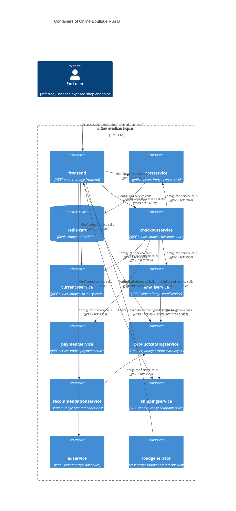

# Online Boutique — recovered container architecture (run B)

## Agent

Codex, GPT-6.

## Files read

- `prompts/1-recover-architecture.md`
- `system/online-boutique/protos/demo.proto`
- `system/online-boutique/kubernetes-manifests/adservice.yaml`
- `system/online-boutique/kubernetes-manifests/cartservice.yaml`
- `system/online-boutique/kubernetes-manifests/checkoutservice.yaml`
- `system/online-boutique/kubernetes-manifests/currencyservice.yaml`
- `system/online-boutique/kubernetes-manifests/emailservice.yaml`
- `system/online-boutique/kubernetes-manifests/frontend.yaml`
- `system/online-boutique/kubernetes-manifests/kustomization.yaml`
- `system/online-boutique/kubernetes-manifests/loadgenerator.yaml`
- `system/online-boutique/kubernetes-manifests/paymentservice.yaml`
- `system/online-boutique/kubernetes-manifests/productcatalogservice.yaml`
- `system/online-boutique/kubernetes-manifests/README.md`
- `system/online-boutique/kubernetes-manifests/recommendationservice.yaml`
- `system/online-boutique/kubernetes-manifests/shippingservice.yaml`

## Containers table

Scope: the workloads defined by the supplied manifests, including the separately defined loadgenerator. Base Kustomization membership is shown in `system/online-boutique/kubernetes-manifests/kustomization.yaml` (lines 17–28); loadgenerator is commented out at line 24. Kubernetes Service resources route to workloads and are not additional C4 containers. The `frontend-check` init container belongs to loadgenerator (`system/online-boutique/kubernetes-manifests/loadgenerator.yaml`, lines 40–71).

Implementation languages: **Not evidenced in the provided files** for all application services and loadgenerator. Technologies below describe the evidenced interfaces/images. Responsibilities from protobuf describe API contracts, not verified implementations.

| Name | Technology/language | Responsibility | Evidence (file path and symbol/line) |
|---|---|---|---|
| `frontend` | HTTP server; image frontend; implementation language unknown | [Inferred] Shop web entry point; exposes HTTP and configures backend service addresses. | `system/online-boutique/kubernetes-manifests/frontend.yaml` (`image`, `PORT`, `readinessProbe.httpGet`, `*_SERVICE_ADDR`, `frontend-external`; lines 47–84, 124–136) |
| `cartservice` | gRPC server; image cartservice; implementation language unknown | Add items, retrieve a cart and empty a cart. | `system/online-boutique/kubernetes-manifests/cartservice.yaml` (`Deployment`, `image`, Service port `grpc`; lines 18, 46, 80–82); `system/online-boutique/protos/demo.proto` (`CartService`, lines 23–27) |
| `redis-cart` | Redis; image redis:alpine; language not applicable | [Inferred] Cart data store, selected by cartservice REDIS_ADDR; /data uses emptyDir. | `system/online-boutique/kubernetes-manifests/cartservice.yaml` (`REDIS_ADDR`, `redis-cart`, `image: redis:alpine`, `volumeMounts`, `volumes`; lines 50–51, 92, 118–141) |
| `checkoutservice` | gRPC server; image checkoutservice; implementation language unknown | Accept order placement; configured to contact six backend services. | `system/online-boutique/kubernetes-manifests/checkoutservice.yaml` (`image`, `*_SERVICE_ADDR`, Service port `grpc`; lines 45, 57–68, 88–90); `system/online-boutique/protos/demo.proto` (`CheckoutService.PlaceOrder`, lines 224–226) |
| `currencyservice` | gRPC server; image currencyservice; implementation language unknown | List supported currencies and convert money. | `system/online-boutique/kubernetes-manifests/currencyservice.yaml` (`image`, Service port `grpc`; lines 46, 80–82); `system/online-boutique/protos/demo.proto` (`CurrencyService`, lines 140–143) |
| `emailservice` | gRPC server; image emailservice; implementation language unknown | Expose order confirmation sending API; delivery mechanism is unknown. | `system/online-boutique/kubernetes-manifests/emailservice.yaml` (`image`, Service port `grpc`, port 5000 to targetPort 8080; lines 46, 81–83); `system/online-boutique/protos/demo.proto` (`EmailService.SendOrderConfirmation`, lines 199–201) |
| `paymentservice` | gRPC server; image paymentservice; implementation language unknown | Accept a charge request and return a transaction ID; real payment processing is unknown. | `system/online-boutique/kubernetes-manifests/paymentservice.yaml` (`image`, Service port `grpc`; lines 46, 79–81); `system/online-boutique/protos/demo.proto` (`PaymentService.Charge`, `ChargeResponse.transaction_id`, lines 177–179, 193–195) |
| `productcatalogservice` | gRPC server; image productcatalogservice; implementation language unknown | List, retrieve and search products. | `system/online-boutique/kubernetes-manifests/productcatalogservice.yaml` (`image`, Service port `grpc`; lines 46, 79–81); `system/online-boutique/protos/demo.proto` (`ProductCatalogService`, lines 71–75) |
| `recommendationservice` | gRPC server; image recommendationservice; implementation language unknown | Return recommended product IDs; configured to contact productcatalogservice. | `system/online-boutique/kubernetes-manifests/recommendationservice.yaml` (`image`, `PRODUCT_CATALOG_SERVICE_ADDR`, Service port `grpc`; lines 46, 60–61, 83–85); `system/online-boutique/protos/demo.proto` (`RecommendationService.ListRecommendations`, `ListRecommendationsResponse`, lines 56–58, 65–67) |
| `shippingservice` | gRPC server; image shippingservice; implementation language unknown | Quote shipping cost and accept a shipping request returning a tracking ID; actual carrier integration is unknown. | `system/online-boutique/kubernetes-manifests/shippingservice.yaml` (`image`, Service port `grpc`; lines 45, 79–81); `system/online-boutique/protos/demo.proto` (`ShippingService`, `ShipOrderResponse`, lines 107–110, 126–128) |
| `adservice` | gRPC server; image adservice; implementation language unknown | Return advertisements for supplied context keys. | `system/online-boutique/kubernetes-manifests/adservice.yaml` (`image`, Service port `grpc`; lines 46, 81–83); `system/online-boutique/protos/demo.proto` (`AdService.GetAds`, `AdRequest.context_keys`, lines 243–250) |
| `loadgenerator` | Client process; image loadgenerator; BusyBox init check; implementation language unknown | [Inferred] Generate frontend traffic (USERS=10, RATE=1); explicitly checks frontend over HTTP before startup. Defined separately; excluded from base Kustomization. | `system/online-boutique/kubernetes-manifests/loadgenerator.yaml` (`Deployment`, `frontend-check`, `FRONTEND_ADDR`, `USERS`, `RATE`; lines 17, 40–87); `system/online-boutique/kubernetes-manifests/kustomization.yaml` (commented resource, line 24) |

## Dependencies table

Service-address variables establish configured dependencies. gRPC is supported by each target Service port named `grpc`, gRPC probes and its matching protobuf service; execution paths and TLS settings remain unverified. The end-user role is [Inferred] from frontend exposure. Loadgenerator dependencies apply when its separate manifest is deployed.

| Caller → callee | Protocol | Evidence (file path and symbol/line) |
|---|---|---|
| End user → `frontend` | HTTP / TCP 80 to 8080 | `system/online-boutique/kubernetes-manifests/frontend.yaml` (`frontend-external`, `type: LoadBalancer`, port `http:80`, `targetPort:8080`, lines 124–136). [Inferred] Human end-user role; endpoint exposure is explicit. |
| `frontend` → `productcatalogservice` | gRPC / TCP 3550 | `system/online-boutique/kubernetes-manifests/frontend.yaml` (`PRODUCT_CATALOG_SERVICE_ADDR=productcatalogservice:3550`, lines 69–70); `system/online-boutique/kubernetes-manifests/productcatalogservice.yaml` (Service port `grpc`, lines 79–81); `system/online-boutique/protos/demo.proto` (`ProductCatalogService`) |
| `frontend` → `currencyservice` | gRPC / TCP 7000 | `system/online-boutique/kubernetes-manifests/frontend.yaml` (`CURRENCY_SERVICE_ADDR=currencyservice:7000`, lines 71–72); `system/online-boutique/kubernetes-manifests/currencyservice.yaml` (Service port `grpc`, lines 80–82); `system/online-boutique/protos/demo.proto` (`CurrencyService`) |
| `frontend` → `cartservice` | gRPC / TCP 7070 | `system/online-boutique/kubernetes-manifests/frontend.yaml` (`CART_SERVICE_ADDR=cartservice:7070`, lines 73–74); `system/online-boutique/kubernetes-manifests/cartservice.yaml` (Service port `grpc`, lines 80–82); `system/online-boutique/protos/demo.proto` (`CartService`) |
| `frontend` → `recommendationservice` | gRPC / TCP 8080 | `system/online-boutique/kubernetes-manifests/frontend.yaml` (`RECOMMENDATION_SERVICE_ADDR=recommendationservice:8080`, lines 75–76); `system/online-boutique/kubernetes-manifests/recommendationservice.yaml` (Service port `grpc`, lines 83–85); `system/online-boutique/protos/demo.proto` (`RecommendationService`) |
| `frontend` → `shippingservice` | gRPC / TCP 50051 | `system/online-boutique/kubernetes-manifests/frontend.yaml` (`SHIPPING_SERVICE_ADDR=shippingservice:50051`, lines 77–78); `system/online-boutique/kubernetes-manifests/shippingservice.yaml` (Service port `grpc`, lines 79–81); `system/online-boutique/protos/demo.proto` (`ShippingService`) |
| `frontend` → `checkoutservice` | gRPC / TCP 5050 | `system/online-boutique/kubernetes-manifests/frontend.yaml` (`CHECKOUT_SERVICE_ADDR=checkoutservice:5050`, lines 79–80); `system/online-boutique/kubernetes-manifests/checkoutservice.yaml` (Service port `grpc`, lines 88–90); `system/online-boutique/protos/demo.proto` (`CheckoutService`) |
| `frontend` → `adservice` | gRPC / TCP 9555 | `system/online-boutique/kubernetes-manifests/frontend.yaml` (`AD_SERVICE_ADDR=adservice:9555`, lines 81–82); `system/online-boutique/kubernetes-manifests/adservice.yaml` (Service port `grpc`, lines 81–83); `system/online-boutique/protos/demo.proto` (`AdService`) |
| `checkoutservice` → `productcatalogservice` | gRPC / TCP 3550 | `system/online-boutique/kubernetes-manifests/checkoutservice.yaml` (`PRODUCT_CATALOG_SERVICE_ADDR=productcatalogservice:3550`, lines 57–58); `system/online-boutique/kubernetes-manifests/productcatalogservice.yaml` (Service port `grpc`, lines 79–81); `system/online-boutique/protos/demo.proto` (`ProductCatalogService`) |
| `checkoutservice` → `shippingservice` | gRPC / TCP 50051 | `system/online-boutique/kubernetes-manifests/checkoutservice.yaml` (`SHIPPING_SERVICE_ADDR=shippingservice:50051`, lines 59–60); `system/online-boutique/kubernetes-manifests/shippingservice.yaml` (Service port `grpc`, lines 79–81); `system/online-boutique/protos/demo.proto` (`ShippingService`) |
| `checkoutservice` → `paymentservice` | gRPC / TCP 50051 | `system/online-boutique/kubernetes-manifests/checkoutservice.yaml` (`PAYMENT_SERVICE_ADDR=paymentservice:50051`, lines 61–62); `system/online-boutique/kubernetes-manifests/paymentservice.yaml` (Service port `grpc`, lines 79–81); `system/online-boutique/protos/demo.proto` (`PaymentService`) |
| `checkoutservice` → `emailservice` | gRPC / TCP 5000 | `system/online-boutique/kubernetes-manifests/checkoutservice.yaml` (`EMAIL_SERVICE_ADDR=emailservice:5000`, lines 63–64); `system/online-boutique/kubernetes-manifests/emailservice.yaml` (Service port `grpc`, lines 81–83); `system/online-boutique/protos/demo.proto` (`EmailService`) |
| `checkoutservice` → `currencyservice` | gRPC / TCP 7000 | `system/online-boutique/kubernetes-manifests/checkoutservice.yaml` (`CURRENCY_SERVICE_ADDR=currencyservice:7000`, lines 65–66); `system/online-boutique/kubernetes-manifests/currencyservice.yaml` (Service port `grpc`, lines 80–82); `system/online-boutique/protos/demo.proto` (`CurrencyService`) |
| `checkoutservice` → `cartservice` | gRPC / TCP 7070 | `system/online-boutique/kubernetes-manifests/checkoutservice.yaml` (`CART_SERVICE_ADDR=cartservice:7070`, lines 67–68); `system/online-boutique/kubernetes-manifests/cartservice.yaml` (Service port `grpc`, lines 80–82); `system/online-boutique/protos/demo.proto` (`CartService`) |
| `recommendationservice` → `productcatalogservice` | gRPC / TCP 3550 | `system/online-boutique/kubernetes-manifests/recommendationservice.yaml` (`PRODUCT_CATALOG_SERVICE_ADDR=productcatalogservice:3550`, lines 60–61); `system/online-boutique/kubernetes-manifests/productcatalogservice.yaml` (Service port `grpc`, lines 79–81); `system/online-boutique/protos/demo.proto` (`ProductCatalogService`) |
| `cartservice` → `redis-cart` | Redis / TCP 6379 | `system/online-boutique/kubernetes-manifests/cartservice.yaml` (`REDIS_ADDR=redis-cart:6379`, lines 50–51; `image: redis:alpine`, line 118; Service port `tcp-redis`, lines 154–156). Exact Redis commands: Not evidenced in the provided files. |
| `loadgenerator` → `frontend` | HTTP / TCP 80 to 8080 | `system/online-boutique/kubernetes-manifests/loadgenerator.yaml` (`frontend-check` command `wget ... http://${FRONTEND_ADDR}`, line 49; `FRONTEND_ADDR=frontend:80`, lines 69–70, 82–83); `system/online-boutique/kubernetes-manifests/frontend.yaml` (Service `http`, lines 119–121). Main traffic generation is [Inferred]; HTTP init check is explicit. |

## Mermaid diagram

The diagram contains the same 12 containers and 17 dependencies as the tables. Loadgenerator is defined but excluded from the base Kustomization. No external system is sufficiently established by the supplied evidence.

## Gaps

Additional files below are suggested evidence only; none was opened. Candidate source paths have not been verified.

| Gap | What the allowed evidence establishes or leaves unknown | Extra evidence that would settle it |
|---|---|---|
| Implementation languages and frameworks | Not evidenced in the provided files. A proto `go_package` option (demo.proto line 19) specifies generated Go package placement, not every server implementation language. | Each service implementation entry point and Dockerfile under `system/online-boutique/src/<service>/` (candidate paths; not opened). |
| Shopping assistant endpoint and activation | `system/online-boutique/kubernetes-manifests/frontend.yaml` lines 83–84 configures `SHOPPING_ASSISTANT_SERVICE_ADDR=shoppingassistantservice:80`; `ENABLE_ASSISTANT` is commented at lines 93–94. No matching Deployment, Service or proto API is provided. Runtime activation, protocol and service boundary: Not evidenced in the provided files. Excluded from tables and diagram pending that evidence. | `system/online-boutique/kustomize/components/shopping-assistant/kustomization.yaml` (candidate, referenced component at `system/online-boutique/kubernetes-manifests/kustomization.yaml:35`) and frontend client/feature-flag implementation. |
| Configured calls versus observed execution | The dependency table establishes configured destinations and advertised protocols; call order, selected RPC methods, timeouts, retries, authentication and transport encryption: Not evidenced in the provided files. Proto methods alone do not establish caller relationships. | Client implementations under `system/online-boutique/src/frontend/`, `src/checkoutservice/`, `src/recommendationservice/` and `src/cartservice/`; an execution trace would verify actual calls. |
| Real payment, email and shipping integrations; other stores or brokers | Not evidenced in the provided files. `PaymentService.Charge`, `EmailService.SendOrderConfirmation` and `ShippingService.ShipOrder` in `system/online-boutique/protos/demo.proto` establish API contracts, not payment-provider, SMTP or carrier dependencies. No additional store or broker is shown by the supplied manifests. | Implementation and runtime configuration under `system/online-boutique/src/paymentservice/`, `src/emailservice/`, `src/shippingservice/` and any service suspected of persistence (candidate locations). |
| Redis data model and recovery | `system/online-boutique/kubernetes-manifests/cartservice.yaml` mounts `/data` from `emptyDir` (lines 129–141). Persistent-volume-backed recovery, Redis persistence settings, key schema and failure behavior: Not evidenced in the provided files. | Cart storage implementation under `system/online-boutique/src/cartservice/`, Redis startup configuration and any deployment storage overrides. |
| Effective deployment and load generator execution | `system/online-boutique/kubernetes-manifests/README.md` lines 3–5 says Skaffold must insert image tags. `system/online-boutique/kubernetes-manifests/kustomization.yaml:24` comments out loadgenerator and refers to its Skaffold module. Exact deployed image versions and whether loadgenerator is running: Not evidenced in the provided files. | `system/online-boutique/skaffold.yaml` (named by the manifest comment), selected deployment overlays and the resolved deployment manifest. |
| End-user behavior and public HTTPS | [Inferred] A person uses the externally exposed frontend; HTTP port 80 is explicit in `system/online-boutique/kubernetes-manifests/frontend.yaml` lines 124–136. Specific user journeys and HTTPS termination: Not evidenced in the provided files. | Frontend routes/templates under `system/online-boutique/src/frontend/` and any ingress or load-balancer TLS configuration. |
